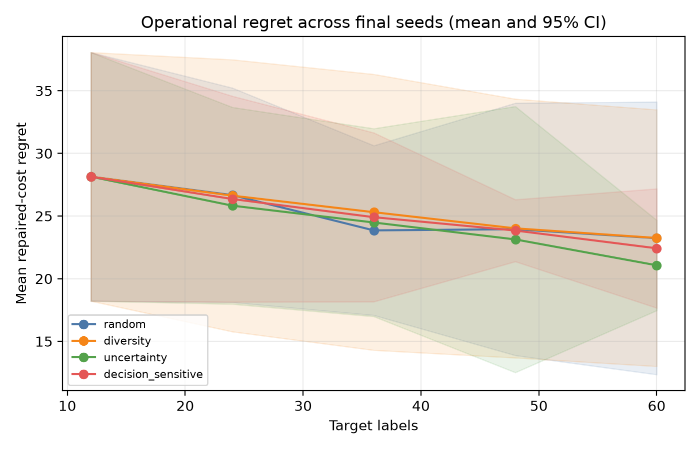

# Value-Guided SCED

**[Read the paper (PDF)](paper/main.pdf)** · [LaTeX source](paper/main.tex)

Research code for studying which target-topology operating conditions should receive expensive security-constrained economic dispatch (SCED) labels when adapting a learned dispatch surrogate after an unseen line outage.

The scientific contract is in [`docs/protocol.md`](docs/protocol.md), and all frozen machine-readable choices are in [`configs/base.yaml`](configs/base.yaml). The repository contains the complete frozen experiment: the DC-SCED oracle, MLP ensemble, four acquisition strategies, deterministic repair, three-seed outputs, figures, and manuscript.

## Findings

**Research question:** Which target-topology operating conditions should receive scarce SCED labels to adapt a dispatch surrogate after a line outage?

**Preregistered hypothesis (H5):** Decision-sensitive acquisition would reduce security violations and repaired-cost regret per target-oracle call.

**Result:** H5 was rejected in this experiment. At 60 target labels, uncertainty sampling had the lowest mean dispatch MAE (1.387 MW) and repaired-cost regret (21.06); raw security feasibility was 0% for every method under the frozen tolerances. Results average three seeds and are descriptive.



The initial protocol, including H5, was committed on **10 August 2026**, before the main experiment runs: [protocol at the pre-experiment commit `d5c1015`](https://github.com/DrUkachi/value-guided-sced/blob/d5c1015c17dab13544de0a2be5729ef3e44ef131/docs/protocol.md). Later implementation decisions are recorded in the [experiment-change log](docs/change_log.md).

## Setup

Requires Python 3.10 or newer.

```bash
python -m pip install -e ".[dev]"
```

## Smallest smoke test

After setup, verify both topologies and solve the base dispatch with one command:

```bash
python scripts/smoke_test.py
```

For the complete local verification, run `python scripts/check_environment.py`, `python scripts/solve_verified_dispatch.py`, and `pytest`.

Run `python scripts/run_experiment.py` to reproduce the budget-zero source-only
MLP baseline, paired topology-shift diagnostic, feasibility repair, and initial
results under `results/processed/`.

## Reproduce the frozen study

The committed datasets and initial selections are immutable inputs. Re-run the final seeds and rebuild aggregate outputs with:

```bash
python scripts/run_experiment.py --seed 11
python scripts/run_experiment.py --seed 22
python scripts/run_experiment.py --seed 33
python scripts/aggregate_results.py
python scripts/analyze_results.py
python scripts/freeze_experiments.py --commit 16896e0ecb411fd07b16f4b3d430f88e5606bc7f
```

Results are written under `results/processed/` and `results/figures/`. To build the manuscript, enter `paper/` and run `pdflatex main`, `bibtex main`, then `pdflatex main` twice.

The interview package is in `interview/`: `slides.pdf` contains the five-slide deck, while `interview_package.md` contains the three- and seven-minute narratives, likely questions, and the two-pass live-rehearsal sheet.

## Experimental workflow

1. Generate source, target-candidate and untouched target-test operating conditions.
2. Solve the source and selected target conditions with the SCED oracle.
3. Train a compact MLP ensemble.
4. Compare random, diversity, uncertainty and decision-sensitive acquisition under equal budgets.
5. Report predictive error, raw security feasibility, repair magnitude and repaired-cost regret.

The frozen Tuesday datasets are generated with `uv run python scripts/generate_data.py`.
The command refuses to overwrite an existing dataset; `--force` is reserved for a
documented protocol change.

Freeze the common initial target cases for all experiment seeds with
`uv run python scripts/freeze_initial_labels.py`. Acquisition selection sees only
candidate identifiers and features; the label store reveals oracle outputs after
each selected batch.
