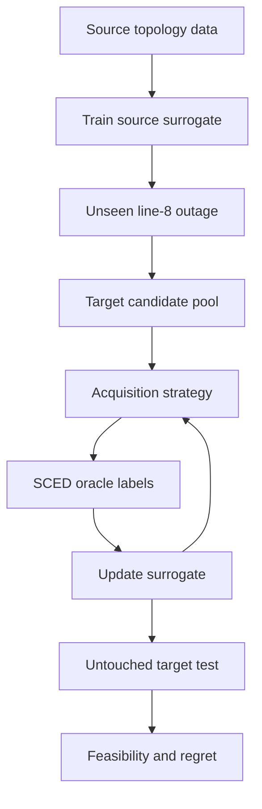

# Experimental Protocol

**Status:** Frozen core design for the initial experiment. Changes to the decisions below must be documented before implementation and must not be motivated by target-test performance.

## Working title

Which Operating Conditions Are Worth Simulating? Value-Guided Data Acquisition for Security-Constrained Redispatch under Topology Shift

## Primary research question

Under an unseen line-outage topology shift and a limited target-simulation budget, which operating conditions should be labelled by a SCED oracle so that a learned dispatch surrogate minimises security violations and repaired-cost regret?

## Unit of analysis

One operating condition consisting of bus-level demand and renewable-generation values.

## Label

The optimal generator dispatch returned by the target-topology SCED optimisation oracle.

## Structural shift

Line 8 is available in the source topology but removed from the target topology.

## Security contingencies

Outages of lines 3 and 4 are considered within the SCED formulation.

## Target-data budget

Twelve initial target labels followed by four acquisition batches of 12, producing checkpoints at 12, 24, 36, 48 and 60 labels. The source-only model is evaluated at budget 0.

## Untouched evaluation set

Eighty target-topology operating conditions are never available to the acquisition algorithms.

## Terminology

- **Source topology:** The original six-bus grid with line 8 in operation.
- **Target topology:** The changed grid in which line 8 has been removed.
- **Operating condition:** A vector $x=[d_1,\ldots,d_n,r_1,\ldots,r_m]$, where $d_i$ is demand and $r_j$ is renewable generation.
- **Candidate sample:** A target-topology operating condition whose demand and renewable values are known, but whose optimal dispatch label is hidden from the acquisition method.
- **Oracle label:** The optimal secure generator dispatch $g^*(x)=\operatorname{SCED}(x,T_{\mathrm{target}})$.
- **Oracle call:** One execution of the SCED optimisation for one selected target operating condition.
- **Target test sample:** An operating condition and oracle solution reserved exclusively for final evaluation.
- **Acquisition round:** Selecting 12 candidates, revealing their SCED labels, adding them to the training data, retraining and evaluating.

## Experimental matrix

| Component | Decision |
| --- | --- |
| Grid | Synthetic six-bus network |
| Lines | 10 |
| Generators | 4 |
| Source samples | 220 |
| Target candidates | 160 |
| Target test samples | 80 |
| Target outage | Line 8 |
| SCED contingencies | Lines 3 and 4 |
| Initial target labels | 12 |
| Acquisition batch | 12 |
| Maximum target labels | 60 |
| Acquisition methods | Random, diversity, uncertainty, decision-sensitive |
| Surrogate | Compact MLP ensemble |
| Final seeds | 5 |
| Debugging seeds | 1 |
| Optimisation solver | SciPy linear optimisation |
| Primary shift | Source topology to unseen target topology |

The core experiment excludes Real-E, reinforcement learning, pandapower, AC-OPF, and additional grids.

## Hypotheses

- **H1:** The source-trained surrogate will deteriorate on the unseen target topology.
- **H2:** Every target-data acquisition method will improve upon the source-only model.
- **H3:** Uncertainty sampling will reduce predictive error but will not necessarily minimise operational regret.
- **H4:** Diversity sampling will improve input-space coverage without necessarily selecting operationally critical conditions.
- **H5:** Decision-sensitive acquisition will achieve lower security violations and repaired-cost regret per target oracle call.
- **H6:** The ranking of acquisition methods may differ between prediction metrics and operational metrics.

### Valid null result

> Decision-sensitive acquisition may not outperform simple baselines. This would show that the proposed ex-ante value proxy does not reliably predict realised sample value in the controlled setting.

## Acquisition strategies

All strategies choose 12 samples per round from the remaining candidate pool. Ties are broken reproducibly using the experiment seed.

### Random

Select candidates uniformly without replacement.

### Diversity

Standardise candidate inputs using statistics fitted on source-training inputs. Prioritise candidates using farthest-first (k-centre) selection:

$$
a_{\mathrm{div}}(x)=\min_{z\in D_{\mathrm{labelled}}}\lVert x-z\rVert_2.
$$

After each selection within a batch, include that selected input as a centre before choosing the next sample.

### Uncertainty

Train $K=5$ MLPs with different seeded initialisations and calculate ensemble disagreement:

$$
u(x)=\frac{1}{K}\sum_{k=1}^{K}\lVert\hat g_k(x)-\bar g(x)\rVert_2^2.
$$

Select candidates with the largest disagreement.

### Decision-sensitive acquisition

Use the ensemble-mean dispatch with known demand, target topology and PTDFs to estimate base-case and contingency flows. Define criticality as

$$
c(x)=\max_{k,\ell}\frac{|\hat f_{\ell}^{(k)}(x)|}{F_{\ell}^{\max}},
$$

where $k$ covers the base case and the locked line-3 and line-4 contingencies. Min-max normalise uncertainty and criticality over the remaining candidate pool in each round, using zero when a score has zero range, then calculate

$$
a_{\mathrm{decision}}(x)=\widetilde u(x)[1+\lambda\widetilde c(x)],\qquad \lambda=1.
$$

The target-test set cannot be used to tune $\lambda$. A later sensitivity analysis may use validation data only and must be reported separately from the frozen core experiment.

## Evaluation metrics

No single composite score will collapse feasibility and cost.

### Primary operational pair

1. Raw security-feasibility rate.
2. Repaired operating-cost regret.

A method will not be declared best solely because it has low post-repair regret when its raw predictions are frequently infeasible.

### Predictive metrics

- Dispatch MAE.
- Dispatch RMSE.
- Maximum generator error.

### Raw operational metrics

- Power-balance error.
- Generator-limit violation.
- Base-case line overload.
- Contingency line overload.
- Raw feasible-dispatch percentage.
- False-safe rate.

Numerical feasibility tolerances will be fixed with the oracle implementation before experiments are run and recorded in the configuration.

### Post-repair metrics

Repair magnitude is $M_{\mathrm{repair}}=\lVert\hat g_{\mathrm{repair}}-\hat g\rVert_1$. Cost regret is

$$
R(x)=C(\hat g_{\mathrm{repair}})-C(g^*).
$$

Report mean, median, 95th-percentile and worst-case regret.

### Label-efficiency checkpoints

Evaluate at $B\in\{0,12,24,36,48,60\}$, where $B=0$ is the source-only zero-shot model.

## Leakage controls

1. Target-test samples are not included in source training, target training, candidate selection or hyperparameter selection.
2. Candidate inputs are visible to acquisition methods, but candidate SCED labels remain hidden until selection.
3. Target-test labels are used only for evaluation.
4. Input normalisation is fitted using source-training data.
5. Acquisition hyperparameters are not selected using target-test performance.
6. Within each seed, every acquisition strategy begins with the same 12 labelled target samples.
7. Every strategy receives the same number of oracle labels and uses the same retraining schedule, surrogate architecture and feasibility repair procedure.
8. Precomputing candidate labels is permitted for computational convenience, but the acquisition code must not access them before selection.

## Workflow

## End-of-design audit

- [x] Is the research question written in one sentence?
- [x] Is the downstream decision SCED/redispatch rather than generic prediction?
- [x] Is the structural shift physically defined?
- [x] Is one oracle call precisely defined?
- [x] Are source, candidate and test data separated?
- [x] Are acquisition budgets identical?
- [x] Is the decision-sensitive score defined without hidden labels?
- [x] Are raw feasibility and repaired regret both reported?
- [x] Is the target test set excluded from all selection decisions?
- [ ] Does the environment-check script run in the intended environment?
- [x] Is the paper skeleton present?
- [x] Have Real-E, RL, AC-OPF and additional grids been excluded?

## Open implementation decisions

- Operating-condition sampling distributions and admissible ranges.
- Numerical feasibility tolerances and repair formulation.
- Precise train/validation split and training preprocessing beyond source-fitted input standardisation.

These must be resolved without consulting target-test outcomes.

### 10 August daily log

- Completed: Frozen the core scientific design and created the repository and paper skeleton.
- Evidence produced: Protocol, machine-readable configuration, importable package scaffolding, checks and provisional manuscript.
- Decision made: Compare four acquisition methods under identical label budgets using feasibility and regret as separate primary outcomes.
- Remaining uncertainty: Physical grid parameters, operating-condition distribution, feasibility tolerances and exact repair formulation.
- First task on 11 August: Encode the six-bus network and obtain one verified source-topology SCED solution before attempting the machine-learning model.

### 11 August implementation checkpoint

- Encoded a versioned synthetic six-bus parameter set with ten lines, four generators, generator limits and linear costs.
- Added separate source and target topology builders; the target removes line 8 and remains connected.
- Constructed DC branch-incidence, branch-flow and nodal-susceptance matrices.
- Added a SciPy `linprog` DC economic-dispatch solve and a reproducible 200 MW source scenario.
- Saved solver status, dispatch, objective cost and runtime in `results/raw/verified_source_dispatch.json`.
- Added automated topology, matrix and successful-dispatch tests.
- Unresolved for tomorrow: independently validate the synthetic parameters, extend the oracle to locked line-3 and line-4 contingencies, freeze numerical feasibility tolerances, define renewable injections and operating-condition ranges, and specify the repair formulation.
